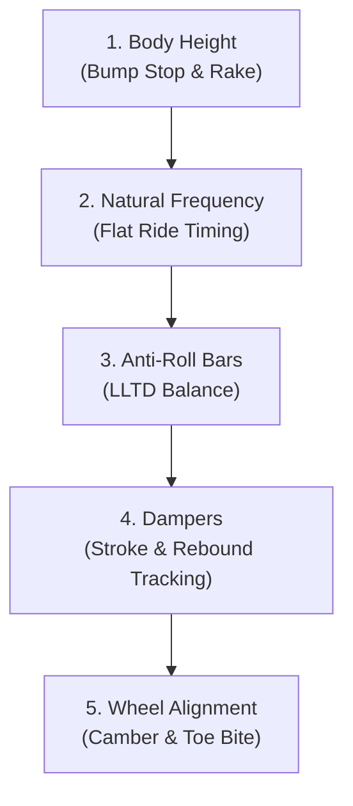

# Real-Life Motorsport Engineering & GT7 (Update 1.72+ / Spec IV) Physics Adaptation

A complete vehicle dynamics translation guide connecting real-world race engineering mathematics to the Gran Turismo 7 simulation engine, supporting both English and Thai in-game terminology.

-----

## 0. Minimum Required Intake Data & In-Game Measurement Telemetry

To build a mathematically sound suspension, differential, and chassis setup in GT7, capture as many of the following parameters from the in-game **Car Settings / Measurement (การวัดค่า)** screen as possible:

    ┌─────────────────────────────────────────────────────────────────────────────┐
    │                   MINIMUM REQUIRED INTAKE DATA CHECKLIST                    │
    ├─────────────────────────────────────────────────────────────────────────────┤
    │ 1. Car Identity & Architecture                                             │
    │    • Car Name & Model Year                                                  │
    │    • Body Style: (SUV, Coupe, Sedan, Hatchback, Roadster, Pickup, Kei, GT) │
    │    • Drivetrain: (FF, FR, MR, RR, AWD / 4WD)                                │
    │    • Dimensions: Length, Width, Height (มม. / mm)                           │
    │                                                                             │
    │ 2. Engine & Power Delivery Characteristics                                  │
    │    • Stock Engine vs Swapped Engine                                         │
    │    • Power & Torque: (HP and N·m) & Peak RPM                                │
    │    • Dyno Curve Shape: Bell-curve High-RPM Peak vs Linear NA vs Flat EV     │
    │                                                                             │
    │ 3. Weight, Balance & Tires                                                  │
    │    • Total Mass (kg) and Distribution (F:R % ratio, e.g. 57:43)             │
    │    • Tire Compound: (Comfort, Sport H/M/S, Racing H/M/S, Dirt/Snow)         │
    │                                                                             │
    │ 4. In-Game Stability & Telemetry Metrics (เสถียรภาพและแรง G)                │
    │    • Stability (เสถียรภาพ): Low Speed & High Speed (-1.00 Under to +1.00 Over)│
    │    • Rotational G-Force (แรง G): 60 km/h, 120 km/h, 240 km/h (G)            │
    │    • Acceleration: 0-400m, 0-1000m, 100-150 km/h                            │
    │                                                                             │
    │ 5. Target Circuit & Operating Environment                                   │
    │    • Track Layout: (e.g. Nürburgring Nordschleife, Spa, Tokyo, Suzuka)      │
    │    • Track Surface Profile: (Bumpy vintage tarmac vs smooth GP asphalt)     │
    │    • Environmental Conditions: (Dry, damp line, wet puddle 0–100%)          │
    └─────────────────────────────────────────────────────────────────────────────┘

### 0.A — Slider Range Intake (MANDATORY for Gr.X / Gr.1 / Formula & Aero-Modified Road Cars)

> ⚠️ **STOP before computing downforce or special car parameters without slider ranges.**
> The GT7 DB does NOT store slider min/max ranges. While stock road cars lack adjustable aero, **any car with GT Auto aerodynamic parts (Front Splitter, Custom Wing, Diffusers) or Gr.X / Gr.1 / Gr.3 / Gr.4 / Formula cars** possess completely custom, unpredictable slider spans (e.g. Front 50–200, Rear 200–350).
>
> **Proactive Intake Rule:**
> If the user has NOT provided their slider min/max ranges upfront:
> 1. In the setup sheet, output the Downforce row with the **proportional span formula** clearly stated (e.g. `[Assumed: Min + 60% span for Medium DF]` or `[Assumed: Min + 10-20% span for Tri-Oval]`).
> 2. Proactively prompt the user: *"If custom GT Auto aero parts/wings are installed, please provide your in-game Downforce slider min–max (e.g., 50-200 / 140-290) to compute exact downforce values."*

    ┌──────────────────────────────────────────────────────────────────┐
    │  SPECIAL CAR & AERO SLIDER INTAKE — Collect before tuning        │
    ├──────────────────────────────────────────────────────────────────┤
    │  Body Height   Front: ___ min → ___ max  (mm) [Gr.X / Hypercar] │
    │  Body Height   Rear:  ___ min → ___ max  (mm) [Gr.X / Hypercar] │
    │  Natural Freq  Front: ___ min → ___ max  (Hz) [Gr.X / Hypercar] │
    │  Natural Freq  Rear:  ___ min → ___ max  (Hz) [Gr.X / Hypercar] │
    │  Downforce     Front: ___ min → ___ max       [Aero-Equipped]    │
    │  Downforce     Rear:  ___ min → ___ max       [Aero-Equipped]    │
    │  Current PP    (on target tire compound): ___                   │
    └──────────────────────────────────────────────────────────────────┘

> **User-provided in-game values ALWAYS override DB values.**
>
> **Why — lessons from testing sessions:**
> - F1500T-A body height max = **60 mm** both (DB assumed road car 90–140 mm)
> - F1500T-A natural freq range = **4.0–6.0 Hz** (DB assumed 2.75–3.60 Hz)
> - F1500T-A downforce range = **Front 700–900 / Rear 1,300–1,700** (DB assumed road car 50–150)
> - Porsche 911 Turbo S '93 w/ GT Auto Aero: Front 50–200 / Rear 140–290 (DB assumed 50–150 / 100–300)
> - Porsche 911 Turbo (930) '81 w/ GT Auto Aero: Front 50–200 / Rear 100–250
> - Camaro ZL1 1LE '18 w/ Custom Wing: Front 200–250 / Rear 300–350 (DB assumed generic road car)
> - Red Bull X2019 Competition (X2019 Nations Cup): Body height Front 45–50 mm / Rear 50–60 mm; Natural Freq 4.00–6.00 Hz both; Downforce Front 800–1200 / Rear 1200–1600 (DB assumed generic road car)
> - Toyota Supra GT Road Car (JZA80): Body height Front/Rear 65–105 mm; Natural Freq Front/Rear 1.50–3.50 Hz; Downforce Front 200 (fixed) / Rear 400–500 (DB assumed generic road car 90–140 mm). Note: Clamp rear downforce to floor (400) to counter locked front 200.
> - Citroën 2 CV 6 Charleston '86 (w/ Full Custom Suspension & GT Auto Aero): Body height Front 100–225 mm / Rear 100–255 mm; Natural Freq 1.00–3.00 Hz both; Damping Comp 20–40% / Exp 30–60%; Downforce Front 50–200 / Rear 100–250 (DB ultralight heuristic assumed 60–70 mm if unprovided).
- Subaru Impreza Rally Car '98 (Gr.B): Body height Front/Rear 80–190 mm; Natural Freq 1.50–3.00 Hz both; Damping Comp 20–40% / Exp 30–80%; Downforce Front 100–150 / Rear 150–250.
>
> Aero recommendation formula (when user provides or calculates range):
> - **Tri-Oval / Super Speedway (Blue Moon Bay, Daytona, Route X)**: Front 10–20% of span from min / Rear 10–20% of span from min (Low-drag high-Vmax spec; relies on stiff 3.10–3.30 Hz springs to carry banking compression).
> - **Low drag road circuits (Le Mans, Monza)**: Front 40% of span / Rear 40% of span.
> - **Medium DF (Laguna Seca, Yas Marina, Spa, Grand Valley)**: Front 60% of span / Rear 60% of span.
> - **High DF (Tsukuba, Autopolis, Deep Forest)**: Front 80% / Rear 75% of span.

### 0.B — Community Research & Patch-Awareness Protocol (MANDATORY Date/Patch Filter)

> 🛑 **CRITICAL RULE WHEN RESEARCHING TUNES ONLINE (GTPlanet, YouTube, Reddit, Social Media)**:
> Gran Turismo 7's physics engine has undergone **three major seismic resets**. A tune created for an older physics patch is NOT just slightly suboptimal — **it is completely broken, unusable, and dangerous** under modern physics.
>
> Whenever researching or validating setups, you MUST verify the publication date and target patch version:

| Release Period | GT7 Patch Era | Physics State & Status | Research & Usage Verdict |
| :--- | :--- | :--- | :--- |
| **Before July 25, 2024** | **Pre-v1.49** (v1.00 – v1.48) | Digital slip, no bump-stop modeling, slammed heights, ultra-stiff 3.5–4.5 Hz springs. | ❌ **DEAD & INVALID**. Never use. Causes violent bouncing, tire-fender clipping, bottoming out, and severe understeer. |
| **July 25, 2024 – Aug 19, 2026** | **v1.49 – v1.70** | Introduced bump stops, tire deflection, and fender collision geometry. | ⚠️ **TRANSITIONAL**. Requires audit. May still recommend the drift Steering Angle Adapter or have suboptimal differential coast lock settings. |
| **Aug 20, 2026 – Oct 14, 2026** | **v1.71** | Revised tire slip curves, per-car Ackermann steering kinematics, refined damper tracking. | ✅ **VALID (Core Physics)**. Road car tunes remain valid; verify Gr.1–Gr.4 baseline defaults and light-car ballast limits. |
| **October 15, 2026 – Present** | **v1.72+ (Spec IV)** | Retains v1.71 tire/kinematic physics; revises Gr.1/Gr.2/Gr.3/Gr.4 default suspension & LSD settings; enforces ballast max-weight & F:R positioning limits on light vehicles. | ✅ **CURRENT & VALID**. Fully compliant with Spec IV regulations and physics. |

#### Web Search & Inquiry Protocol
When searching online for reference setups:
* **Strict Date Filter**: Only accept setups published **after July 25, 2024** (post-1.49), with priority given to setups explicitly marked **v1.71 / v1.72+ (Spec IV)** (after August–October 2026).
* **Required Search Query Patterns**:
  * `site:gtplanet.net ("1.72" OR "1.71") "<Car Name>" tune`
  * `"GT7" "<Car Name>" suspension tune 1.72`
  * If searching Google/Reddit: append `after:2024-07-25` or `1.72`.
* **Red Flag Detection (Instant Disqualification)**:
  * ❌ Recommends slammed minimum ride height (`50–60 mm` on road cars).
  * ❌ Recommends spring frequencies $>3.50\text{ Hz}$ on road cars without massive downforce.
  * ❌ Instructs installing the **Steering Angle Adapter (ตัวปรับมุมเลี้ยว)** for grip racing.

-----

## 1. GT7 Thai Localization & Real-World Translation Dictionary

    [Real-World Race Engineering]       [GT7 English In-Game]         [GT7 เมนูภาษาไทย]
    ─────────────────────────────────────────────────────────────────────────────────────────────
    Ride Height (Ground Clearance) ───►  Body Height Adjustment     ───► ความสูงของตัวรถ (มม.)
    Natural Frequency (Wheel Rate) ───►  Natural Frequency (Hz)     ───► ความถี่ธรรมชาติ (Hz)
    Roll Stiffness Dist. (LLTD)    ───►  Anti-Roll Bar (1–10)       ───► เหล็กกันโคลง (1–10)
    Bump Damping (Compression)     ───►  Damping Ratio (Comp %)     ───► อัตราการยุบตัวของโช้คอัพ (%)
    Rebound Damping (Expansion)    ───►  Damping Ratio (Exp %)      ───► อัตราการคืนตัวของโช้คอัพ (%)
    Negative Camber Angle          ───►  Negative Camber Angle (°)  ───► มุมแคมเบอร์ลบ (องศา °)
    Toe Alignment (In / Out)       ───►  Toe Angle (In / Out °)     ───► มุมโท (โทอิน In / โทเอาท์ Out °)
    LSD Clutch Preload             ───►  LSD Initial Torque (0–30)  ───► ทอร์กเริ่มต้น (0–30)
    LSD Drive Ramp Angle           ───►  LSD Accel Sensitivity      ───► ความไวการเร่ง (0–100)
    LSD Coast Ramp Angle           ───►  LSD Braking Sensitivity    ───► ความไวการเบรก (0–100)
    Brake Proportioning Bias       ───►  Brake Balance Controller   ───► ตัวควบคุมสมดุลเบรก (-5 ถึง +5)
    Aerodynamic Downforce          ───►  Downforce (Front / Rear)   ───► แรงกด (หน้า / หลัง)

-----

## 2. In-Game Telemetry & Performance Curve Interpretation

### A. Stability Index Diagnostics & Understeer Remediation (การแก้ปัญหารถดื้อโค้ง/เลี้ยวไม่ออก)
* **Scale**: `-1.00` (Extreme Understeer / ดื้อโค้งสุด) $\longleftrightarrow$ `0.00` (Perfect Neutral / สมดุลเป็นกลาง) $\longleftrightarrow$ `+1.00` (Extreme Oversteer / ท้ายปัดสุด).
* **Diagnosing & Remedying Understeer ("เลี้ยวไม่ค่อยออก / ดื้อโค้ง")**:
  1. **Unlock LSD Braking Sensitivity (`20–25` on 0–100 scale)**: *Critical Root Cause!* Overly high braking sensitivity (>40) forces both rear wheels to rotate at the same speed during trail-braking, creating massive yaw resistance and pushing the nose straight. Dropping to `20–25` frees the rear axle to pivot into apexes.
  2. **Biased Front Downforce**: Set Front Downforce to maximum (`100`) and Rear Downforce to `65–80` to suck the front tires into the asphalt and prevent high-speed nose float.
  3. **Widen ARB Asymmetry**: Soften Front ARB (`2–3`) and stiffen Rear ARB (`6–8`) to transfer dynamic roll load to the rear, biting front grip and forcing rear rotation.
  4. **Rearward Brake Balance**: Set Brake Balance Controller to **`-2` to `-3` (Rear Bias)** to unload front tires under braking, leaving 100% front tire friction capacity for steering.
  5. **Increase Front Toe-Out**: Set to `Out 0.12° to 0.15°` for razor-sharp turn-in response.
  6. **Positive Rake Angle**: Lower front ride height relative to rear by `+8 to +12 mm` (e.g. Front 60mm / Rear 72mm).

* **Diagnosing High-Speed Snap-Oversteer / Instability (e.g. High Speed > +0.30)**:
  1. Increase Rear Toe-In (`In 0.20° to 0.30°`).
  2. Increase LSD Braking Sensitivity (`55–65` on 0–100 scale).
  3. Increase Rear Rebound Damping (`50%–58%`) to prevent tail float over crests.

### B. Dyno Powerband & Extreme Power-to-Weight (>500–600 HP/Ton) Tuning
* **Ultra-Lightweight & Extreme Power-to-Weight (เช่น Caterham R500 340 HP / 506 kg = 672 HP/ton)**:
  * *Behavior*: Extreme acceleration torque-to-mass causes violent rear squat and instant snap-oversteer when applying throttle mid-corner.
  * *Tuning Protocol*:
    * **LSD Acceleration Sensitivity**: Clamp strictly to **`20–26`** (never exceed 28 on 0–100 scale) so differential allows progressive slip rather than violent 100% lockup under sudden boost/power delivery.
    * **Rear Compression Damping (Bump)**: Stiffen to **`34%–36%`** (Anti-Squat) to prevent violent rear chassis collapse and front nose lift on throttle exit.
    * **Rear Negative Camber**: Set to **`-1.6°`** to maximize the longitudinal tire contact patch for straight-line power transfer.
* **Bell-Curve Peak at High RPM (High-Boost Turbo / เช่น 788 N·m ที่ 8,367 RPM)**:
  * *Behavior*: Low torque down low followed by a violent boost spike in the upper rev range.
  * *Tuning Solution*:
    * Keep **LSD Acceleration Sensitivity conservative (`20–26` on 0–100 scale)** so the differential does not instantly bind 100% when boost hits mid-corner.
    * Stiffen **Rear Compression Damping (`34%–38%`)** to prevent violent rear squat under sudden boost delivery.
* **Linear NA / Supercharged / Flat EV Torque**:
  * *Behavior*: Instantaneous, predictable torque delivery.
  * *Tuning Solution*: Can run higher **LSD Acceleration Sensitivity (`30–45` on 0–100 scale)** on standard-weight chassis for maximum drive traction out of slow corners.

### C. In-Game Slider Scales vs Raw Database Dimensions (ความสูงตัวถัง vs สเกลสไลเดอร์ในเกม)
* **Database Discrepancy Note**: The raw database (`cars_master.json`) stores external overall vehicle body dimensions (Length/Width/Height from roof/roll bar), **NOT** the adjustable suspension slider range in GT7.
* **Chassis Slider Archetypes**:
  * *Standard Road Cars / Sedans / Coupes*: Slider range typically `90–140 mm` or `100–150 mm`.
  * *Ultra-Lightweight / Open-Cockpit (Caterham, BAC Mono, Radicals)*: Slider range typically `55–100 mm` or `60–105 mm`.
  * *Gr.3 / GT Racecars*: Slider range typically `50–90 mm` or `55–95 mm`.
* **Universal Relative Rake Formula**: Always calculate ride height relative to the car's in-game slider minimum:
  $$\text{Body Height}_{\text{Front}} = \text{Slider}_{\text{Min}} + 5\text{ to }10\text{ mm (Travel Buffer)}$$
  $$\text{Body Height}_{\text{Rear}} = \text{Body Height}_{\text{Front}} + 8\text{ to }12\text{ mm (Positive Rake)}$$

### D. G-Force Capacity & Spring Frequency Mapping
* **Low Lateral G (<1.15G)**: Comfort / Sport tires; use compliant frequencies (`2.20–2.50 Hz`).
* **High Lateral G (1.25G – 1.60G+)**: Sport Soft / Racing tires with high mechanical grip; supports stiff frequencies (`2.75–3.20 Hz`) and aggressive camber (`-2.8° to -3.5°`).

### E. Trail-Braking Diagnostics & Driving Style Invariant (การปรับแต่งสไตล์ Trail-Braking และถนอมยางหน้า Dual Invariant)
> 🏁 **DEFAULT INVARIANT — Trail-Braking & Tire-Saver Synergy**:
> By default, all road car, Gr.4, and Gr.3 circuit setups MUST balance trail-braking apex rotation with front tire longevity:
> 1. **Zero/Low-Scrub Front Toe (`0.00°` or `Out 0.02°`)**: Never use aggressive toe-out (>0.04°) on endurance runs. Generate trail-brake rotation via unlocked LSD and brake balance, NOT tire scrub.
> 2. **Mild Front Camber (`-1.8° to -2.0°`)**: Prevents inner shoulder thermal degradation under heavy straight-line braking.
> 3. **LSD Braking Calibration**: Keep strictly between **`12–16`** (FR, FF, AWD) or **`42–48`** (MR) to rotate chassis effortlessly without scrubbing front tires.
> 4. **Rearward Brake Bias (`-1` to `-3`)**: Relieves decelerative saturation from front tires, leaving friction capacity for steering.
> 5. **Soft Front ARB (`2–3`) vs Stiff Rear (`6–7`)**: Shifts dynamic cornering roll burden to the rear outside tire, protecting front tire shoulders.
> 6. **Moderate Front Downforce**: Avoid maxing front downforce; keep at 40%–60% of span to prevent carcass overheating on high-speed straights.

* **Symptom 1: Immediate Understeer at 10–30% Brake Pedal (แตะเบรกนิดเดียวแล้วดื้อหน้าทันที)**
  1. **Unlock LSD Braking Sensitivity**: Drop rear LSD Braking to `12–16` (Critical!).
  2. **Uninstall Steering Angle Adapter**: Check Car Settings → Steering. Revert to Standard Steering (eliminates tire scrub from parallel geometry).
  3. **Turn off ASM**: Disable Active Stability Management in Driving Options (stops automatic outside front brake intervention).
  4. **Check Front Fender Clearance (GT7 1.49+)**: If wide body/wheels are fitted, front pitch under braking can cause tire-fender clipping, locking steering throw. Raise front ride height by +5 to +10 mm.
  5. **Soften Rear Damping Expansion**: Drop rear rebound to `42%–46%` to allow the rear chassis to lift and transfer load forward.

* **Symptom 2: Wheel Shudder / Twitching under Deep Braking (เบรกลึกแล้วล้อกระตุก / ABS Micro-Lock)**
  1. **Moderate Rear Brake Bias**: Extreme rearward bias (`-3` to `-5`) causes the unloaded rear tires to lock prematurely during heavy deceleration pitch (>70% pedal), triggering high-frequency ABS pulsing. Move bias to **`-1` or `-2`**.
  2. **Increase LSD Braking Sensitivity on Solid/Live Axles**: Increase rear LSD Braking from `12` to **`18–24`** (on 0–100 scale) to prevent the inside rear wheel from chattering when trail-braking into corner entry.
  3. **Increase Front Bump Damping (Compression)**: Stiffen front compression from `28%` to **`31–33%`** to prevent the front dampers from bottoming out onto bump stops under peak deceleration.

#### 2.E.1 — Drivetrain Architecture Trail-Braking Matrix (FF / FR / MR / RR / AWD)

| Layout | Mass Dist. | LSD Braking | Brake Bias | Rear Rebound | Front Toe | Rear Toe | Core Trail-Braking Mechanism & Critical Warning |
| :--- | :---: | :---: | :---: | :---: | :---: | :---: | :--- |
| **FF** | ~62:38 | `10–12` | `+1 to +2` | `38%–42%` | `Out 0.08°` | `In 0.04°` | Soft front ARB (2) + Stiff rear ARB (8-9). *Warning*: Never use rear brake bias; light tail will snap violently. |
| **FR** | ~55:45 | `12–15` | `-2 to -3` | `42%–46%` | `Out 0.06°` | `In 0.08°` | Unlocks rear axle for instant yaw pivot. Relieves front tire braking load. |
| **MR** | ~42:58 | `42–50` | `0 to -1` | `50%–54%` | `Out 0.04°` | `In 0.22°` | Moderate-high LSD brake acts as yaw damper. *Warning*: Unlocking LSD <35 causes instant high-speed snap spin! |
| **RR** | ~38:62 | `55–65` | `-1 to -2` | `48%–52%` | `Out 0.04°` | `In 0.30°` | Heavy rear pendulum. Needs high LSD braking + heavy rear toe-in + positive rake (+10mm) to pin front nose. |
| **AWD** | ~55:45 | F:`10` / R:`14` | `-2 to -3` | `44%–48%` | `Out 0.06°` | `In 0.12°` | Front LSD fully open + Center torque split 35:65/40:60 so front wheels steer without drivetrain binding. |

### 2.F — Proactive Dual-Trim Delivery Invariant (Tire-Saver & Max Stability Quick-Trims)
> 🏁 **STANDARD OUTPUT RULE — Never Make the User Ask for Tire-Save or Stability Trims**:
> Whenever delivering a primary circuit setup sheet, **always append a compact 4–5 row Quick-Trims delta table** below the main sheet:
> 1. **Tire-Saver Spec (โหมดถนอมยาง / WTC 700 & 800 Endurance)**:
>    - Spring Frequency: Soften by `-0.20 to -0.25 Hz` (stops pounding the tire carcass).
>    - Negative Camber: Reduce to `-2.4° Front / -1.2° Rear` (eliminates inner shoulder thermal degradation during straight-line braking).
>    - Toe Alignment: Low-scrub `Out 0.02° Front / In 0.06° Rear` (cuts continuous rolling resistance on long straights).
>    - LSD Accel Sensitivity: Reduce to `18–20` (stops corner-exit wheelspin micro-scrub).
>    - AWD Center Split: Move from aggressive `35:65` to balanced `40:60` (spreads acceleration tire wear evenly).
> 2. **Max Stability Spec (โหมดเน้นความนิ่ง / Anti-Snap & High-Speed Calm)**:
>    - Rear Toe-In: Increase to `In 0.18° to 0.22°` (anchors rear axle under braking and power).
>    - Anti-Roll Bar: Balance closer to `Front 4 / Rear 5` (reduces snap roll transitions).
>    - LSD Braking Sensitivity: Increase by `+10 to +15` clicks (acts as yaw damper; suppresses trailing-throttle snap).
>    - Rear Rebound Damping: Stiffen by `+4% to +6%` (pins rear down over crests and curbs).
>    - Rear Downforce: Increase rear aero by `+15% to +20%` span.

-----

## 3. Parameter Physics Breakdown: Focused Suspension & Alignment Dynamics (Update 1.71+)

In GT7 Update 1.71+, suspension tuning is governed by **bump stop stroke limits**, **tire deflection**, **fender clearance**, and **per-car steering kinematics**. The 5 core suspension parameters must be tuned as an integrated system:



### A. Body Height (Ride Height / Ground Clearance - ความสูงตัวรถ มม.)
* **The 1.71+ Bump-Stop Constraint**: If ride height is set to minimum, forward pitch under braking compresses the damper onto the rubber bump stop, causing an immediate, violent spike in wheel rate that bounces the front tires off the track.
* **Safe Travel Buffer Formula**:
  $$\text{Body Height}_{\text{Front}} = \text{Slider}_{\text{Min}} + 10\text{ to }15\text{ mm}$$
* **Positive Rake Angle ($\Delta h$)**:
  $$\text{Body Height}_{\text{Rear}} = \text{Body Height}_{\text{Front}} + 6\text{ to }12\text{ mm}$$
  * *Mechanism*: Generates forward aerodynamic pitch load, biting front tires on turn-in while ensuring the rear diffuser does not stall.
* **Tire-to-Fender Collision Geometry & Widebody**: If Wide Offset or Wide Wheels are fitted in GT Auto (or the `--widebody` flag is set), low front ride height causes tire-fender scrub under braking pitch, locking steering throw. Raise front ride height by an additional `+5 to +8 mm` (the tuner CLI adds `+5 mm` when `--widebody` is specified).
* **2D Trail-Braking Dynamic Bottoming Clearance Model**:
  Under aggressive trail-braking at speed $v$ (km/h) into high-G corner entry, the outside front corner experiences three simultaneous dynamic deflections:
  1. **Aerodynamic Heave Deflection ($\Delta z_{aero}$)**: Downforce increases quadratically with speed:
     $$F_{z, aero} = \frac{1}{2} \rho v^2 C_L A \quad \Longrightarrow \quad \Delta z_{aero} = \frac{F_{z, aero, front}}{K_{axle, front}}$$
  2. **Longitudinal Braking Pitch Dive ($\Delta z_{pitch}$)**: Deceleration $a_x$ transfers load forward across wheelbase $L$:
     $$\Delta F_{z, braking} = \frac{m \cdot a_x \cdot h_{cg}}{L} \quad \Longrightarrow \quad \Delta z_{pitch} = \frac{\Delta F_{z, braking}}{K_{axle, front}}$$
  3. **Lateral Roll Deflection ($\Delta z_{roll}$)**: Cornering acceleration $a_y$ creates roll torque partitioned by ARB roll stiffness:
     $$\Delta z_{roll} = \frac{\theta_{roll} \cdot t_{front}}{2} \quad \text{where } \theta_{roll} = \frac{m \cdot a_y \cdot h_{roll}}{K_{\phi, total}}$$
  - **Dynamic Clearance**:
    $$h_{dynamic} = h_{static} - (\Delta z_{aero} + \Delta z_{pitch} + \Delta z_{roll})$$
  - **Bottoming Risk Threshold**: If $h_{dynamic} < 25\text{ mm}$, the front chassis/fender strikes bump stops or clips the tire under combined trail-braking load. The tuner triggers an automatic warning and computes the required ride height elevation or spring stiffening.

### B. Natural Frequency ($f_n$ in Hz) $\leftrightarrow$ Wheel Rate ($K_w$)
* **First-Principles Equation**:
  $$f_n = \frac{1}{2\pi} \sqrt{\frac{K_w}{m_s}} \quad \Longleftrightarrow \quad K_w = (2\pi f_n)^2 \cdot m_s$$
* **1.71+ Compliance Rule**:
  * **Road Cars (Comfort / Sport Tires)**: Clamp strictly to **`2.20 – 2.80 Hz`**. Setting road cars to $\ge 3.20\text{ Hz}$ causes tire skip over surface irregularities and triggers bump stop bounce.
  * **Downforce Racecars (Gr.3 / Gr.1 / LMH)**: Set to **`3.20 – 3.80 Hz`** to prevent the chassis from bottoming out under massive high-speed aerodynamic downforce.
* **Flat Ride Principle**: Timing the rear frequency slightly higher than the front ensures that rear bounce catches up with front bounce over bumps, converting chassis pitch into flat vertical heave:
  $$f_{n, \text{rear}} \approx 1.05\text{ to }1.10 \times f_{n, \text{front}}$$
* **Front-Heavy FR/AWD Exception (57:43+ on Bumpy Tracks like Nürburgring)**:
  * Front: `2.60–2.80 Hz` (Supports heavy cast-iron engine blocks without bottoming out).
  * Rear: `2.65–2.75 Hz` (Compliant rear digs for longitudinal traction on throttle exit).

### C. Anti-Roll Bars (Roll Stiffness Distribution & LLTD - เหล็กกันโคลง 1–10)
* **Lateral Load Transfer Distribution (LLTD) Rule**: Anti-roll bars control body roll **without increasing vertical heave stiffness**. Increasing roll stiffness at one axle transfers more dynamic lateral weight to the outside tire on that axle, **reducing that axle's net grip**:
  * Stiffer Front ARB $\rightarrow$ Increases Understeer (front slides first).
  * Stiffer Rear ARB $\rightarrow$ Increases Oversteer (rotates vehicle into apex).
* **1.71+ Asymmetry Tuning**:
  * **Front-Heavy FR / FF Platforms (55:45+)**: Soften Front ARB (`1–3`) and stiffen Rear ARB (`6–8`) to eliminate terminal corner-entry push.
  * **Mid-Engine (MR) & Rear-Engine (RR)**: Stiffen Front ARB (`5–7`) and moderate Rear ARB (`5–7`) to prevent high-speed snap-oversteer.

### D. Damper Ratios $\leftrightarrow$ Critical Damping (อัตราการยุบตัวและคืนตัว %)
* **Kinematic Ratio Rule**:
  $$\frac{\text{Expansion % (Rebound)}}{\text{Compression % (Bump)}} = 1.40\text{ to }1.65$$
* **Bump Damping / Compression (`28%–33%`, Clamped $\le 40\%$)**:
  * Cushions unsprung mass and decelerative pitch.
  * If front compression is too soft ($<26\%$), the car dives too fast and slams the bump stops under threshold braking. Set front compression to **`30%–33%`** on heavy front-engine cars. In GT7, compression is strictly clamped to $\le 40\%$.
* **Rebound Damping / Expansion (`40%–56%`, Clamped $\le 80\%$)**:
  * **Rear Rebound for Trail-Braking Rotation**: Lower to **`40%–44%`** to allow the rear chassis to lift and transfer load forward when trail-braking.
  * **Rear Rebound for High-Speed Crest Stability**: Stiffen to **`48%–56%`** on undulating circuits (Nürburgring Flugplatz, Bathurst Skyline) to prevent the rear from floating and snapping over crests. In GT7, expansion is strictly clamped to $\le 80\%$.

### E. Wheel Alignment: Negative Camber & Toe (มุมแคมเบอร์และมุมโท)
* **Negative Camber (Front `-2.4° to -3.4°` / Rear `-1.2° to -1.8°`)**:
  * *1.71+ Trade-off*: Excessive negative camber degrades longitudinal braking and acceleration traction. Never exceed `-1.8°` on driven rear wheels unless lateral G exceeds 1.50G.
* **Toe Angle Alignment**:
  * **Front Toe-Out (`Out 0.06° to 0.15°`)**: Pre-loads the outside front tire on initial steering input, providing immediate, razor-sharp turn-in.
  * **Rear Toe-In (`In 0.08° to 0.25°`)**: Provides essential straight-line dynamic stability and prevents trailing-throttle snap during high-speed deceleration.

### F. Complementary Systems (LSD, Brake Bias & Aerodynamics Summary)
* **LSD Column Placement by Drivetrain (CRITICAL FORMATTING INVARIANT)**:
  * **FF (Front-Wheel Drive)**: Driven wheels are in front. Always output LSD values (`Initial Torque`, `Accel Sens`, `Braking Sens`) in the **Front (หน้า)** column and `-` in the **Rear (หลัง)** column. Never place FF LSD values under the Rear column.
  * **FR / MR / RR (Rear-Wheel Drive)**: Output `-` in the **Front (หน้า)** column and LSD values in the **Rear (หลัง)** column.
  * **AWD / 4WD**: Output LSD values in **both** Front and Rear columns.
* **LSD Braking Sensitivity**: `22–28` for solid/live axle FR cars (stabilizes axle chatter); `52–65` for MR/RR platforms (prevents trail-braking snap).
* **Brake Balance Controller**: Set to **`-1` to `-2` (Rear Bias)** on front-heavy platforms to unload front tires without triggering deep-braking rear ABS shudder.
* **Downforce Balance & Center of Pressure (CP)**: Match aerodynamic Center of Pressure to vehicle mass distribution (e.g. 40% front / 70% rear span for MR/RR; 45% front / 55% rear for Gr.X). Avoid pinning the rear down with max downforce while leaving the front weak. When front aero is fixed/locked (e.g. Supra GT Road Car front 200), clamp rear downforce to floor (400) to maintain balance.

-----

## 4. Vehicle Architecture Deep-Dive

    ┌─────────┬────────────────────────────┬──────────────────────────────────┬─────────────────────────────┐
    │ Layout  │ Mass Dist. / Polar Inertia │ Primary Handling Challenge       │ Core Tuning Remedy          │
    ├─────────┼────────────────────────────┼──────────────────────────────────┼─────────────────────────────┤
    │ **FF**  │ ~62:38 / High Front        │ Heavy understeer, friction limit │ Soft Front ARB, Stiff Rear  │
    │ **FR**  │ ~50:50 to 57:43 / Medium   │ High-speed push or power snap    │ Rake +8mm, ARB 3/7, LSD Brk 26 │
    │ **Muscle**│ ~58:42 / Massive Front V8│ Terminal entry push, live axle   │ Rake +12mm, ARB 2/8, LSD Brk 22 │
    │ **MR**  │ ~42:58 / Very Low          │ High-speed lift-off snap spin    │ High Rear Damping & Braking │
    │ **RR**  │ ~38:62 / High Rear Pendulum│ Light nose push, exit snap spin  │ High Rear Toe-In & LSD Lock │
    │ **AWD** │ ~55:45 / High Traction     │ Corner entry & mid-corner push   │ 35:65 Split, Soft Front ARB │
    │ **SUV** │ ~56:44 / High CG ($h_{cg}$)│ High roll moment, bump-stop slam │ Tall Height, Stiff Base ARB │
    │ **EV**  │ ~50:50 / High Mass (2t+)   │ Inertial scrub, tire overheating │ Max $f_n$ (3.10+ Hz), Camber│
    └─────────┴────────────────────────────┴──────────────────────────────────┴─────────────────────────────┘

> ⚠️ **CRITICAL RULE — Gr.4 AWD / 4WD Center Differential Lock (WRX Gr.4, Lancer Evo Gr.4, Audi TT Cup, etc.):**
> In GT7, racecars in the **Gr.4 category with AWD/4WD CANNOT install or adjust the Torque-Distributing Center Differential** (ศูนย์กลางการกระจายแรงบิด). It is fixed by homologation rules (locked at 50:50 or fixed mechanical split).
> Because you cannot transfer drive bias rearward to force throttle-on yaw rotation, you **MUST** eliminate corner-entry and mid-corner push via:
> 1. **Ultra-Loose Front LSD**: Keep Front Initial Torque `5`, Accel `14–16`, and Braking `18–20` so the front differential does not bind or drag the nose straight.
> 2. **Extreme ARB Asymmetry**: Set Front ARB to `2–3` and Rear ARB to `7–8` to force dynamic roll transfer to the rear outside tire.
> 3. **Rearward Brake Bias**: Set Brake Balance Controller to `-2` or `-3` (Rear) to utilize trail-braking pitch to rotate the chassis into apexes.
> 4. **Front Camber & Toe-Out**: Run `-3.4° to -3.6°` Front Camber and `Out 0.08° to 0.12°` Front Toe-Out for crisp turn-in bite.

> 📌 **Update 1.72 (Spec IV) — Gr.1 / Gr.2 / Gr.3 / Gr.4 Default Suspension & Differential Reset:**
> Update 1.72 revised the stock/default suspension and LSD gear values across all **Gr.1, Gr.2, Gr.3, and Gr.4** racecars. Do not rely on pre-1.72 stock baseline numbers when calculating relative adjustments or evaluating BoP handling—always read the live in-game default sliders first.

-----

## 5. Body Style Dynamics

* **Sedan / Saloon (3-box, long wheelbase, e.g., JZX100 Mark II / Chaser)**: High straight-line stability, but naturally pushes in high-speed sweepers. Requires `+8 to +12 mm` positive rake, soft front ARB (`3`), stiff rear ARB (`6–7`), and front toe-out (`0.08°–0.12°`).
* **Hatchback (2-box, short rear overhang)**: Agile rotation; run `+1` forward brake bias and moderate rear toe-in (`0.08°`) to stabilize straight-line decel.
* **Coupe / Fastback (Low CG, rigid)**: Supports lower ride height (`95–100 mm`) and balanced ARBs (`4/5`).
* **Convertible / Open-Top**: Soften ARBs (`3–4`) and lower spring frequency (`2.30–2.60 Hz`) to prevent chassis skitter. Always install Roll Cage & Rigidity in GT Auto.
* **Kei Cars (650–850 kg)**: Low mass requires soft frequencies (`2.10–2.40 Hz`) and compliant ARBs (`3–5`). If swapped with 300+ HP (13B/Hayabusa), limit LSD Accel to `20–26` and rear toe-in `0.22°–0.28°`.

### 5.A — Classic American Muscle Cars (1960s–1970s FR Heavy-Nose Dynamics & Terminal Understeer Remediation)
* **Archetype Cars**: Shelby G.T.350 '65, Mustang Boss 429 '69, Mustang Mach 1 '71, Camaro Z28 '69, Dodge Challenger R/T '70, Dodge Charger R/T 426 Hemi '68, Plymouth Superbird '70, Pontiac Firebird Trans Am '78, Corvette C2/C3.
* **The 58:42 Front Cast-Iron V8 Paradox**:
  * Massive cast-iron engine blocks (Windsor 289, 426 Hemi, 429 Boss, 350/427 V8) sit heavily over or in front of the front axle, producing **57:43 to 60:40** front weight bias with massive polar rotational inertia.
  * In stock or default GT7 setup, these cars exhibit **terminal understeer ("เลี้ยวไม่เข้าเลย / ดื้อโค้งสนิท")** on corner entry, followed by violent power oversteer on exit.
* **Root Causes & Race-Engineering Solutions (Update 1.71+ Physics)**:
  1. **LSD Braking Sensitivity Calibration (`22–26` on 0–100 scale, Critical!)**: Default LSD braking (45–55) locks both rear tires together under deceleration. With a 58% heavy front end, a locked rear axle creates immense resistance to vehicle yaw, pushing the car straight. Lowering to `22–26` frees the rear axle to pivot into apexes while maintaining enough differential resistance to prevent inside wheel hop and axle chatter on live rear axles.
  2. **Inverted Aerodynamic Balance (Max Front Downforce)**: Vintage cars suffer from severe front aerodynamic lift at speed. Always install GT Auto Front Lip and set **Front Downforce to Maximum (`100`)**, while keeping Rear Downforce moderate (`85–110`). Pinning the rear down with 180+ downforce while leaving the front weak pins the car in terminal push.
  3. **Extreme ARB Asymmetry (`Front 1–2 / Rear 8–9`)**: Softening the front ARB allows the heavy front end to roll and bite into the asphalt, while a stiff rear ARB transfers dynamic roll stiffness to the outside rear tire, forcing tail rotation.
  4. **Aggressive Positive Rake (`+10 to +14 mm`)**: Set Front ride height low (`95–98 mm`) and Rear high (`108–112 mm`) to pitch aerodynamic load forward and shift static weight into the front contact patch.
  5. **Brake Balance Controller (`-1 to -2 Rear Bias`)**: Shifting braking moderately rearward unloads front tires under light trail braking without inducing deep-braking rear ABS shudder or micro-lock.
  6. **Aggressive Front Toe-Out (`Out 0.12° to 0.15°`) & Camber (`-3.0° to -3.4°`)**: Pre-loads the outside front tire on turn-in to overcome the massive inertia of the V8 block.
  7. **Hardware & Settings Traps in Tuning Shop & Driving Options**:
     * ⛔ **CRITICAL TRAP — NEVER install Steering Angle Adapter (ตัวปรับมุมเลี้ยว) for Grip Racing**: In GT7, this part is exclusively for drift builds. It eliminates Ackermann steering geometry, making front wheels steer in parallel. In grip racing, turning scrubs the front tires; applying even 10% brake input immediately saturates front friction, causing instant terminal understeer ("เลี้ยวไม่เข้าเลย"). Always keep steering at **Normal / Standard Steering**.
     * ⛔ **Driving Assists Interference**: Turn **Active Stability Management (ASM) → OFF** and **Countersteering Assistance → OFF**. If ASM is ON, the game detects yaw during trail-braking and automatically clamps the outside front brake to straighten the vehicle, causing sudden understeer. Set ABS to **Default** or **Weak**.
     * **Roll Cage & Body Rigidity (โรลเคจ)**: Install in GT Auto to eliminate vintage unibody flex that degrades dynamic camber under cornering loads.

### 5.B — Modern High-Performance Heavyweight EVs (2+ Tons: Hyundai IONIQ 5 N / 6 N, Porsche Taycan, Tesla Model S/3)
* **Archetype Cars**: Hyundai IONIQ 6N '25 (2,210 kg, 650 HP), Hyundai IONIQ 5 N '24 (2,210 kg, 650 HP), Porsche Taycan Turbo S '19 (2,295 kg), Tesla Model S Plaid (2,162 kg), Tesla Model 3 Performance.
* **The 50:50 Low-CG Skateboard Paradox**:
  * Batteries mounted across the floor pan yield a near-perfect **50:50 static weight distribution** and a very low center of gravity ($h_{cg}$).
  * However, the sprung corner mass is colossal: **~485–520 kg per wheel**! Instantaneous electric motor torque (flat torque from 0 RPM) combined with 2+ tons creates immense cornering momentum, leading to **severe inertial scrub and rapid tire overheating** if tuned like a normal road car.
* **Tuning Protocol (GT7 Update 1.71+ Physics)**:
  1. **Ride Height Buffer (Bump-Stop Avoidance)**:
     * Never set ride height to minimum! A 2.2-ton car bottoming out onto rubber bump stops causes violent snap-oversteer or total steering loss.
     * Formula: $\text{Body Height}_{\text{Front}} = \text{Slider}_{\text{Min}} + 10\text{ mm}$ (e.g. if slider min is 105 mm, set Front to **`115 mm`**).
     * Set $\text{Body Height}_{\text{Rear}} = \text{Body Height}_{\text{Front}} + 7\text{ mm}$ (e.g. **`122 mm`**) for positive rake downforce.
  2. **High-Span Natural Frequency (85%–90% of Slider Max)**:
     * Do NOT run soft road frequencies (2.20–2.50 Hz). A 2.2t EV will roll excessively and fold tire sidewalls.
     * Target **`2.90 – 3.05 Hz` Front / `3.05 – 3.15 Hz` Rear** (operating at 85%–90% of the slider max). Stiff spring rates keep the chassis flat, protect the tire shoulders, and prevent bump-stop bottoming.
  3. **Torque-Distributing Center Differential (`35:65` Front:Rear Split)**:
     * Since EVs are road cars (not homologated Gr.4), always purchase and install the **Torque-Distributing Center Differential**.
     * Shifting power to **`35:65`** (or `30:70`) eliminates electric AWD corner-exit push and allows the rear motor to pivot the car into apexes.
  4. **Stiff Compression Damping (Anti-Dive)**:
     * Set Compression to **`32%–34%`** front and rear to control the massive vertical heave and pitch under braking.
  5. **Negative Camber & Toe**:
     * Front Camber: **`-3.0°`** (resists lateral roll distortion from 2.2 tons).
     * Rear Camber: **`-1.4° to -1.8°`** (maintains contact patch for 650+ HP electric acceleration).
      * Rear Toe-In: **`In 0.12° to 0.16°`** (stabilizes heavy rear deceleration).
   6. **Brake Balance Controller (`-1 to -2 Rear Bias`)**:
      * Shifts stopping force rearward to relieve the heavily loaded front tires from the 2.2-ton forward pitch.

### 5.C — Dirt & Off-Road Jump Dynamics (Anti-Kangaroo & Tank-Slapper Landing Remediation)
* **Archetype Circuits & Classes**: Colorado Springs, Fishermans Ranch, Sardegna Windmills; Gr.B AWD Rally cars, AWD Rally road conversions.
* **Failure Mode 1: Vertical Trampoline / Kangaroo Hopping ("กระโดดเด้งเป็นจิงโจ้")**:
  1. **Spring Frequency at Absolute Floor**: Run Natural Frequency at or within 0.05 Hz of slider minimum (`1.45–1.55 Hz`). Stiff springs store massive energy on compression and catapult the chassis upwards on rebound.
  2. **High Rebound Damping / Expansion (`74%–78%` on 80% scale)**: Essential shock brake. Traps the compressed spring at the bottom of its stroke and prevents secondary bounce oscillations.
  3. **Body Height Shock Travel Buffer**: Avoid absolute maximum ride height. Back off by `10–15 mm` (e.g. 190–195 mm when max is 210 mm) to leave droop travel and prevent dampers violently slamming internal top-out bump stops.
  4. **Bump Compression (`25%–27%`)**: Soft enough to absorb high-velocity ground impact without jolting, but firm enough to catch chassis mass before bottoming out.
* **Failure Mode 2: Asymmetric Touchdown Yaw / Tank Slapper ("ลงพื้นแล้วเป๋แถซ้าย-ขวา")**:
  1. **Unlock Differential (LSD Accel & Braking to `10–15`)**: *Critical Root Cause!* Cars rarely land 100% flat on loose dirt. A locked LSD binds both wheels together; when one tire makes contact slightly before the other, wheel speed disparity violently kicks the axle laterally. Unlocking LSD allows wheels to sync independently on touchdown.
  2. **Moderate AWD Front Bias (`40:60` split)**: Shifts torque forward so front wheels actively pull the nose straight on throttle out of landing dips, rather than allowing a 30:70/35:65 rear-bias to kick the tail sideways.
  3. **Soft Anti-Roll Bars (`1 / 1`)**: Disconnects left-right roll coupling, allowing independent wheel deflection over asymmetric dirt ruts and angled landings without torquing the chassis across the roll axis.
  4. **Stabilizing Rear Toe-In (`In 0.14° to 0.18°`)**: Pre-loads rear tire yaw resistance, instantly damping lateral swaying when normal load hits the tires.

### 5.D — Ladder-Frame Mini-SUVs & Kei Off-Roaders on Road Tarmac (Suzuki Jimny XC '18 & Swapped Platforms)
* **Archetype**: Suzuki Jimny XC '18 (1,030 kg, 53:47, 4WD/AWD, ladder-frame chassis with front & rear 3-link rigid live axles).
* **The 1.47m Width vs 1.72m Height Paradox**:
  * Fitting sticky tarmac tires (Sport/Racing) to an ultra-narrow (1,475 mm) and tall (1,725 mm) SUV creates extreme lateral roll moments and two-wheel rollover risk over curbs.
* **Tarmac Road Track Conversion Protocol**:
  1. **Elevated Roll Stiffness**: Stiffen Anti-Roll Bars to **`Front 5–6 / Rear 7–8`** and install **Roll Cage** in GT Auto to resist chassis twisting.
  2. **Forward Deceleration Pitch Protection (Brake Bias `0` to `+1 Front`)**:
     * Ultra-short wheelbase (2,250 mm) creates colossal **+48% forward load transfer** under braking.
     * *Critical Warning*: Never set brake balance rearward (-1 to -3); unloaded rear axle will instantly lock and trigger violent snap-spins.
  3. **Mandatory Center Differential (`35:65` Front:Rear Split)**:
     * Purchase Torque-Distributing Center Differential from Tuning Shop. Set to **35:65** to eliminate 50:50 binding push on corner entry.
  4. **Live Axle Trail-Braking Calibration**:
     * Set Rear LSD Braking Sensitivity to **`40–44`** with rebound damping `44%–46%` to suppress live axle hop into apexes.

### 5.E — Gr.B AWD Rally Car Dynamics (Tarmac Circuit vs Dirt Jump Duality)
* **Archetype Cars**: Subaru Impreza Rally Car '98, Ford Focus RS WRC, Peugeot 205 T16 Evolution 2, Audi Sport quattro S1 Pikes Peak, Mitsubishi Lancer Evolution Final Gr.B.
* **The Center Differential Advantage over Gr.4**:
  * Unlike Gr.4 AWD racecars (which are locked at 50:50 mechanical split by homologation), Gr.B rally cars feature a fully adjustable **Torque-Distributing Center Differential (ศูนย์กลางการกระจายแรงบิด)**.
* **Tarmac Circuit Conversion Protocol (ยางเรซซิ่งบนแทร็กทางเรียบ)**:
  1. **Rearward Center Torque Split (`35:65` Front:Rear)**: Eliminates terminal AWD corner-entry push and allows the rear wheels to steer and pivot the chassis on throttle.
  2. **Body Height Buffer**: Set to **`90 / 98 mm`** (+10 mm buffer over 80 mm slider floor to avoid bump stop strikes; +8 mm positive rake).
  3. **High Natural Frequency (`2.60 / 2.72 Hz`)**: Supports high lateral G (1.60G+) without bottoming out under downforce.
  4. **Roll Stiffness Asymmetry**: Front ARB **`3`** / Rear ARB **`7`** to force dynamic roll transfer to the rear outside tire.
  5. **Negative Camber**: Front **`-3.2°`** for high-G apex turn-in bite; clamp rear to **`-1.6°`** to maximize the longitudinal tire contact patch for 4WD exit drive.
  6. **LSD Setup**: Front Initial **`5`** / Accel **`14`** / Braking **`18`** (loose front prevents binding); Rear Initial **`7`** / Accel **`28`** / Braking **`40`** (stabilizes trail-braking).
* **Dirt & Off-Road Jump Protocol (ยางวิบากบนทางดิน/โดดเนิน)**:
  1. **Body Height Shock Buffer (`Max - 15 mm`, e.g. 175 / 175 mm)**: Avoids shock top-out in mid-air.
  2. **Frequency Near Minimum Floor (`1.50–1.55 Hz`)**: Eliminates kangaroo hopping.
  3. **High Rebound Damping (`76%–78%`)**: Traps spring energy to prevent secondary landing bounce.
  4. **Soft ARBs (`1 / 1`) & Open LSDs (`12 / 15`)**: Prevents asymmetric touchdown tank-slapper kicks.
  5. **Center Torque Split (`40:60`)**: Front wheels actively pull the nose straight on landing.

-----

## 6. Universal Tuning Master Table (GT7 1.71+)

| Vehicle Architecture / Body Style | Ride Height (F/R) | Natural Freq (F/R) | ARB (F/R) | Damping (Comp / Exp) | Camber (F/R) | Toe (F/R) | LSD (Init / Acc / Brk) | Brake Bias |
| :--- | :---: | :---: | :---: | :---: | :---: | :---: | :---: | :---: |
| **FF Hot Hatch (62:38)** | `100 / 110 mm` | `3.00 / 2.65 Hz` | `2 / 8` | `35% / 45%` | `-3.2° / -1.2°` | `Out 0.12° / In 0.05°` | `5 / 24 / 22` | `+1` |
| **Kei Car Stock/Mild (64-130 HP)** | `100 / 105 mm` | `2.15 / 2.25 Hz` | `3 / 4` | `28% / 40%` | `-2.2° / -1.4°` | `Out 0.04° / In 0.10°` | `4 / 18 / 22` | `0` |
| **Kei Car Swapped (300+ HP)** | `95 / 102 mm` | `2.55 / 2.65 Hz` | `4 / 6` | `32% / 48%` | `-2.8° / -1.8°` | `Out 0.06° / In 0.24°` | `6 / 26 / 60` | `-1` |
| **Ultra-Lightweight / Open-Cockpit (500–750kg)** | `60 / 72 mm` | `2.75 / 2.85 Hz` | `3 / 6` | `32% / 35%` | `-3.0° / -1.6°` | `Out 0.14° / In 0.08°` | `5 / 28 / 30` | `-2` |
| **FR Lightweight Roadster (50:50)** | `100 / 105 mm` | `2.45 / 2.55 Hz` | `4 / 5` | `30% / 42%` | `-2.4° / -1.6°` | `Out 0.04° / In 0.12°` | `4 / 22 / 30` | `0` |
| **FR High-HP / Turbo Sedan (57:43)** | `100 / 110 mm` | `2.95 / 2.80 Hz` | `3 / 7` | `32% / 48%` | `-3.0° / -1.5°` | `Out 0.10° / In 0.14°` | `5 / 28 / 58` | `-2` |
| **Classic American Muscle FR (58:42)** | `98 / 110 mm` | `2.65 / 2.75 Hz` | `2 / 8` | `31% / 42% (F) 33% / 42% (R)` | `-3.2° / -1.4°` | `Out 0.14° / In 0.08°` | `5 / 28 / 26` | `-2` |
| **MR Supercar Coupe (42:58)** | `95 / 100 mm` | `2.75 / 2.95 Hz` | `5 / 7` | `32% / 44%` | `-2.6° / -1.8°` | `Out 0.05° / In 0.24°` | `6 / 32 / 56` | `0` |
| **RR Porsche 911 Coupe (38:62)** | `95 / 102 mm` | `2.60 / 3.05 Hz` | `7 / 5` | `30% / 48%` | `-2.8° / -2.0°` | `Out 0.06° / In 0.30°` | `7 / 36 / 65` | `0` |
| **4WD Sports / Rally (55:45)** | `100 / 105 mm` | `2.85 / 2.75 Hz` | `3 / 7` | `32% / 45%` | `-2.8° / -1.6°` | `Out 0.08° / In 0.14°` | F:`5/18/22` R:`7/35/48` | `-1` |
| **High-CG SUV / 4WD (57:43)** | `135 / 142 mm` | `2.50 / 2.65 Hz` | `6 / 8` | `36% / 56%` | `-2.4° / -1.4°` | `Out 0.05° / In 0.22°` | F:`6/20/24` R:`7/35/62` | `-1` |
| **Pickup Truck / Live Axle (60:40)** | `145 / 155 mm` | `2.30 / 2.10 Hz` | `5 / 6` | `34% / 62%` | `-2.0° / -1.0°` | `Out 0.04° / In 0.25°` | F:`6/20/22` R:`8/42/65` | `0` |
| **Heavyweight EV AWD (2+ Tons)** | `95 / 100 mm` | `3.10 / 3.00 Hz` | `7 / 5` | `36% / 48%` | `-3.2° / -1.8°` | `Out 0.12° / In 0.25°` | F:`5/18/22` R:`7/36/45` | `-2` |
| **Gr.3 / GT Downforce Racecar** | `65 / 70 mm` | `3.40 / 3.60 Hz` | `6 / 8` | `38% / 52%` | `-3.5° / -2.4°` | `Out 0.10° / In 0.20°` | `6 / 32 / 54` | `0` |
| **Gr.X Red Bull X2019 (46:54 MR)** | `48 / 55 mm` | `5.30 / 5.50 Hz` | `4 / 6` | `33% / 37% (Comp) 48% / 54% (Exp)` | `-3.3° / -2.0°` | `Out 0.04° / In 0.16°` | `6 / 18 / 52` | `0` |
| **Gr.B 4WD Rally Tarmac Spec** | `90 / 98 mm` | `2.60 / 2.72 Hz` | `3 / 7` | `32% / 34% (Comp) 48% / 50% (Exp)` | `-3.2° / -1.6°` | `Out 0.08° / In 0.12°` | F:`5/14/18` R:`7/28/40` | `-1` |
| **4WD Dirt / Off-Road Jump Spec** | `Max - 15mm` | `1.55 / 1.50 Hz` | `1 / 1` | `27% / 76-78%` | `0.0° / 0.0°` | `0.00° / In 0.18°` | F:`5/10/12` R:`5/15/15` | `0` |

-----

## 7. Raw GT7 Database & Telemetry CLI Engine (FGO DB / Atlas Academy Style)

> ⚠️ **DB Reliability Warning (last audited: 2026-10-17 / Update 1.72 Spec IV):**
> - **PP values go stale** after Polyphony PP formula patches. Always confirm current PP in-game.
>   The PP table can lag by 10–20 PP per compound after major updates.
> - **Some Gr.1 / LMH cars were miscategorised** — Ferrari 499P '23, BMW M Hybrid V8 '25,
>   Peugeot 9X8 '25, Porsche 963 '24 were tagged as Gr.3/Road Car with copy-pasted specs.
>   Run `python3 scripts/patch_db.py` to apply known corrections.
> - **Update 1.72 (Spec IV, Oct 15, 2026) Additions**:
>   - **6 New Cars**: `Citroën 2 CV 6 Charleston '86` (FF, 585 kg, 28 PS), `Ferrari F355 Berlinetta '94` (MR, 1,350 kg, 380 PS), `Honda Civic Si Group A version '87` (FF, 890 kg, 225 PS), `Honda Step WGN Spada Premium Line '23` (4WD/AWD Minivan, 1,810 kg, 150 PS), `MAZDA RX-VISION GT3 EVO '26` (FR Gr.3, 1,250 kg), `Xiaomi Vision Gran Turismo` (AWD EV VGT, 1,969 kg, 2,039 PS).
>   - **New Circuit**: `SUGO International Racing Course` (3,586m, high elevation/curb profile, 10% uphill final straight).
>   - **12 New Engine Swaps**: `Citroën 2CV '86` (`B18C`), `Civic Si Gr.A '87` (`B18C`), `Honda Step WGN '23` (triple-swap eligible: `K20C1`, `V12-F3500-A`, `Windsor-351-Maverick`), `Mazda RX-VISION '15` (`R26B`), `Mini Cooper 'S' '65` (`SE75E-2&4`), `Peugeot RCZ Gr.3 Road Car` (`Demon-Challenger`), and Bugatti `Chiron` W16 into `Aventador LP 700-4 '11`, `Diablo GT '00`, `Gallardo LP 560-4 '08`, and `Murciélago LP 640 '09`.
> - **Slider ranges (body height, natural freq, downforce min/max) are NOT in the DB for any car.**
>   Never infer them from car class. Always collect from the user (see Section 0.A).
> - **User-provided in-game values ALWAYS override DB values.**

This skill includes a complete offline raw data engine and calculation toolsuite located in the skill directory, providing programmatic and CLI lookup of all 580+ GT7 cars, 218+ engine swaps, 122+ circuit layouts, and tire-specific PP performance metrics:

### Directory & Modular Library Architecture
The toolsuite is organized into a clean, decoupled library package (`lib/`), database access layer (`db/`), and root runners with full backward compatibility via `scripts/`:

```
gt7-suspension-tuning/
├── cli.py                   # Unified CLI runner (Search, Tune, Trail-Brake Sim)
├── setup.py                 # Core setup calculation synthesis engine
├── models.py                # Strongly-typed dataclasses (CarTelemetry, SuspensionSetup, etc.)
├── constants.py             # Canonical GT7 physical bounds & constants
├── lib/                     # First-principles vehicle dynamics library
│   ├── formulas.py          # Core dynamics formulas (fn, mass, LLTD, bottoming sim)
│   ├── springs.py           # Natural frequency (fn) solver & flat-ride timing
│   ├── shocks.py            # Damping solver (compression <= 40%, expansion <= 80%)
│   ├── wheels.py            # Camber & toe alignment solvers
│   ├── aero_body.py         # Ride height, rake, CP downforce & 2D trail-brake sim
│   ├── drivetrain.py        # LSD & AWD torque split solvers
│   └── trims.py             # Closed-loop stability & dual quick-trims generator
├── db/                      # Database storage & query layer
│   ├── loader.py            # Raw JSON/CSV file loaders & slider persistence
│   └── interface.py         # High-level database query interface & search engine
├── scripts/                 # Backward-compatibility facades (gt7_tuner.py, gt7_db.py)
└── data/                    # Master offline GT7 databases (JSON & CSV)
    ├── cars_master.json     # 580+ cars with physical specs & stock PP
    ├── engine_swaps_master.json # 218+ engine swap combinations
    ├── tracks_master.json   # 122+ circuit layouts, rain & bumpiness ratings
    └── tuning_presets.json  # Calibrated baseline physics archetypes
```

### CLI Database & Tuner Tools

#### A. Database Search (`cli.py` or `scripts/gt7_db.py`)
```bash
# Search car by keyword, model, or chassis code
python3 cli.py --search "R34"
python3 cli.py --search "Porsche 911 GT3"

# Filter by drivetrain, maker, or group
python3 cli.py -m "Toyota" -d "FR"
python3 cli.py -g "Gr.3"

# Check compatible engine swaps (both recipient and donor cars)
python3 cli.py --swaps "R34"
python3 cli.py --swaps "Mazda RX-7"

# Search tracks and check wet weather / rain support
python3 cli.py --tracks "Spa"
python3 cli.py --tracks --rain
```

#### B. Auto-Tuner & Setup Synthesizer (`cli.py` or `scripts/gt7_tuner.py`)
> 🔬 **First-Principles Vehicle Dynamics Engine (No Hardcoded Preset Lookups)**:
> Solves suspension, chassis, alignment, differential, and aerodynamic equations from
> physical telemetry (Mass distribution, Sprung Mass per corner, Lateral G capacity,
> LLTD roll stiffness ratio, Dynamic Braking Load Transfer, Flat Ride Heave/Pitch timing, and
> Aerodynamic Center of Pressure matching).

```bash
# Generate complete race setup for a car on a specific circuit
python3 cli.py "Nissan R34 GT-R V-spec II Nur '02" -t "Nurburgring" --tire RS

# 2D Trail-Braking Bottoming Simulation at 200 km/h with Widebody fender clearance
python3 cli.py "Porsche 911 GT3 RS (991) '16" -t "Spa" --speed 200 --widebody

# Tune with custom in-game downforce slider ranges provided by user
python3 cli.py "Ferrari 296 GTB '22" -t "Spa" --tire RS --df-front 175 275 --df-rear 305 505
python3 cli.py "Shelby G.T.350 '65" -t "Nurburgring 24h" --tire SS --power 500 --df-front 0 100 --df-rear 50 200

# Tune heavy EV with custom in-game height and natural frequency slider ranges
python3 cli.py "Hyundai IONIQ 6N '25" --tire SS --height-range 105 185 --fn-front 1.25 3.15 --fn-rear 1.35 3.25

# Tune with separate Front/Rear height ranges and persist all slider ranges into cars_master.json
python3 cli.py "Citroën 2 CV 6 Charleston '86" --power 141 --height-front 100 225 --height-rear 100 255 --fn-front 1.0 3.0 --fn-rear 1.0 3.0 --df-front 50 200 --df-rear 100 250 --save-sliders

# Apply closed-loop in-game Stability Index (Low/High) and handling symptom trims
python3 cli.py "Ferrari F355 Berlinetta '94" -t "SUGO" --stability -0.35 0.25 --symptom entry_push

# Generate setup with custom horsepower and weight reduction
python3 cli.py "Porsche 911 GT3 RS (991) '16" -t "Spa" --tire RM --power 650 --mass 1280

# Generate specialized setups (modes: grip, time_attack, wet, dirt, drift, endurance)
python3 cli.py "Toyota 86 GT '15" --power 550 --mode drift
python3 cli.py "Mitsubishi Lancer Evolution Final '15" -t "Colorado Springs" --mode dirt
```

-----

## 8. World Touring Car (WTC 600 / 700 / 800) Championship & Endurance Tuning Matrix

### A. Step-by-Step Target PP Balancing Procedure
When tuning cars to meet specific Performance Point regulations (e.g. WTC 600, WTC 700, WTC 800, WTC 900):

1. **Tire Compound Selection (The Baseline PP Anchor)**:
   * **WTC 800**: Start with **Racing Hard (RH)** (optimal for 1-stop endurance) or **Racing Medium (RM)**.
   * **WTC 700**: **Racing Hard (RH)** or **Sport Soft (SS)**.
   * **WTC 600**: **Sport Hard (SH)** or **Sport Medium (SM)**.
2. **Power & Aspiration Matching**:
   * **Gr.3 racecars aiming for 800 PP**: Install **High-RPM Turbo** + Output Adjustment 95–100% (~720–750 HP) to dominate high-speed straights.
   * **High-HP Road cars detuning for 700/800 PP**: Install **Power Restrictor (70–90%)** and **ECU (80–95%)** to flatten torque spikes and save fuel.
3. **Ballast Weight & Placement Trim (Update 1.72 Restrictions)**:
   * If PP is 1–5 points over the cap, add `10–50 kg` ballast.
   * **Positioning**: Position `0 to +15` (rearward) to stabilize FR/MR turn-in; position `-10 to -20` (forward) on RR (Porsche 911) to eliminate front lightness.
   * ⚠️ **v1.72 Ballast Clamp**: Update 1.72 restricts **maximum ballast weight (kg)** on lightweight cars (e.g. Kei cars, 2CV, Mini '65, Caterham) and clamps **ballast positioning** so F:R weight distribution cannot be pushed outside realistic bounds. Do not rely on extreme ballast shifts to fix understeer/oversteer or exploit PP; use ARB asymmetry, rake, and LSD braking sensitivity instead.
4. **Aerodynamic Downforce Trim**:
   * Increasing Front Downforce adds PP; increasing Rear Wing Downforce often slightly lowers PP while significantly stabilizing high-speed stability and preventing snap-oversteer.

### B. Transmission Gearing Formulation for Long Straights & Elevation Climbs
1. **Auto-Set Top Speed Target**: Set to `Track Vmax + 15–20 km/h` (allows drafting/slipstream without hitting the rev limiter).
2. **1st – 2nd Gear**: Tightly spaced for steep uphill hairpin exits (e.g. The Cutting & Forrest's Elbow at Bathurst).
3. **3rd – 5th Gear**: Linear progressive cadence through mid-speed sweepers.
4. **6th / Top Gear**: Calibrated to hit maximum engine redline right before the primary braking zone (e.g. 295–305 km/h before The Chase on Conrod Straight).

### C. Fuel Mapping & Pit Strategy Matrix
* **Fuel Map 1 (Rich / 100% Power)**: Uphill climbs and straightaway overtaking.
* **Fuel Map 2–3 (Moderate Lean)**: Technical downhill and flowing sectors where full throttle is rarely pinned.
* **Fuel Map 6 (Max Lean)**: Traffic trailing, safety preservation, or extending a stint by 2–3 laps.
* **Short-Shifting Technique**: Shift at 70–80% of the rev bar on broad torque curves (V8 NA / Turbo) to save up to 25% fuel per lap with <0.3s lap time delta.

### D. Tire-Conservation & Endurance Suspension Protocol (เซ็ตติ้งเน้นถนอมยางสำหรับเรซยาว)
Whenever tuning for endurance events (WTC 700 / WTC 800, Spa 1h, Sarthe 24h, Nürburgring), apply the **Tire-Saver Protocol** to prevent rapid tire degradation:
1. **Dynamic Mass-Scaled Natural Frequency (ลดความกระด้างสปริง)**:
   * Avoid setting uniform ~2.85+ Hz on lightweight cars (<1,200 kg).
   * Soften spring rate to `2.40 – 2.65 Hz` for lightweight cars (e.g. S15 TC 1000kg) and `2.55 – 2.70 Hz` for ~1300kg cars to let the dampers absorb road vibrations rather than pummeling the tire carcass.
2. **Reduced Negative Camber (ลดการกินขอบยางด้านใน)**:
   * Do NOT run extreme camber (`-3.4° to -3.6°`) in endurance racing as it destroys the inner tire shoulder during straight-line braking.
   * Set **Front Camber to `-2.4° to -2.7°`** and **Rear Camber to `-1.0° to -1.4°`** for even tire temperature and wear distribution.
3. **Low-Scrub Toe Angles (ตัดแรงเสียดทานไถหน้ายางบนทางตรง)**:
   * Set **Front Toe to `Out 0.02° to 0.04°` (or `0.00°`)** to prevent continuous tire scrubbing down 1–2 km straights (Kemmel, Mulsanne).
   * Set **Rear Toe to `In 0.06° to 0.08°`** to balance straight-line stability with minimal rolling friction.
4. **Gentle LSD Acceleration Sensitivity (คุมเฟืองท้ายไม่ให้ล้อฟรีทิ้ง)**:
   * Set Rear LSD Accel to `18 – 24` to prevent power wheelspin out of slow hairpins.

-----

## 9. Extreme Elevation & Crest Dynamic Tuning (Bathurst, Nordschleife, Spa, SUGO)

* **Positive Rake (+7 to +12 mm rear higher)**: Creates front pitch bite while ensuring the rear flat floor doesn't bottom out over blind crests (Skyline, Flugplatz, Eau Rouge).
* **Kinematic Damping Ratio ($\text{Expansion} / \text{Compression} \approx 1.48–1.52$)**:
  * Set Compression to `30–32%` to absorb kerbs and dips.
  * Set Expansion (Rebound) to `46–50%` to pull the chassis down, preventing tail float and snap-oversteer over crests.
* **LSD Braking Sensitivity (`55–65`)**: High braking sensitivity on rear axle provides straight-line trail-braking stability down steep descents (The Esses / The Dipper).
* **SUGO International Racing Course (Update 1.72 Spec)**:
  * *Profile*: 3,586m technical layout with rapid S-bend transitions, aggressive inside sausage curbs, compression dips, and a **10% uphill gradient** on the final corner onto the 704m straight.
  * *Tuning Adjustments*: Add `+3 to +5 mm` ride height buffer over flat-circuit spec, soften ARBs by `1 click` to ride inside curbs without unseating the chassis, and run `48%–54%` rear expansion damping to prevent abrupt rearward weight transfer from unloading the front tires up the 10% climb.

-----

## 10. GT7 Community Databases & External Resources

1. **[GTPlanet GT7 Car Tuning Forum](https://www.gtplanet.net/forum/threads/gt7-car-tuning.404868/)**: The largest community garage library with thousands of tunes indexed by car, PP cap (600/700/800), and physics version.
2. **[GT7Info (DDM999)](https://ddm999.github.io/gt7info/)**: Real-time dealership rotation tracker (Used Car & Legendary Car dealers) and raw game database (`data.json`).
3. **[GTPlanet Engine Swap Compatibility List](https://www.gtplanet.net/forum/threads/gran-turismo-7-engine-swap-compatibility.405033/)**: Live community-verified registry of all engine swap compatibility combinations.
4. **[Kudosprime GT7 Database](https://www.kudosprime.com/gt7/)**: Detailed car specifications, PP calculations, and historical pricing.
5. **[TelemetryIQ (a1exus)](https://github.com/a1exus/TelemetryIQ)**: GT7 UDP telemetry logger, track coordinates, and live browser dashboard.


